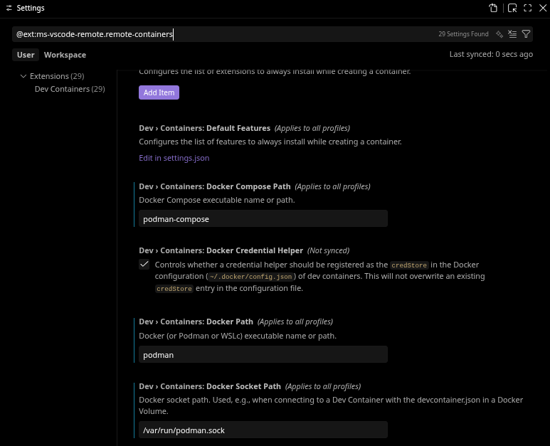

# Setup Guide

This is a guide for setting up this repository for development

## Requirements

- x86 computer running a linux distribution, preferribly using Wayland
- podman, docker will work but some settings and scripts may need to be adjusted
- Visual Studio Code
    - Dev Containers extension

## Container Setup 

1. Install podman on machine

    e.g. `sudo apt install podman`, `sudo pacman -S podman`...

2. Install `Dev Containers` exetension for VSCode and adjust settings

    Change docker compose and docker path to podman, refer to following image:

    

3. Create a cache of xauthority file
    ```bash
    ./Tools/setup/xauthority_setup.sh
    ```

3. Build a simulation image

    ```bash
    cd Tools
    ./build_container_image.sh
    ```

4. Create a devcontainer configuration

    ```bash
    ./Tools/setup/create_devcontainer_configuration.sh
    # Follow steps when prompted and ensure to give json a lookover
    ```

5. Open dev container

    i. Bring up command pallete in VSCode (ctrl+P)

    ii. *Build and open* container for first time with `Dev Containers: Rebuild and Reopen in Container` and select your container if prompted

    - Once container is built, you can use `Reopen in Container`, note that you may need to run step 3 everytime you reboot your computer.


